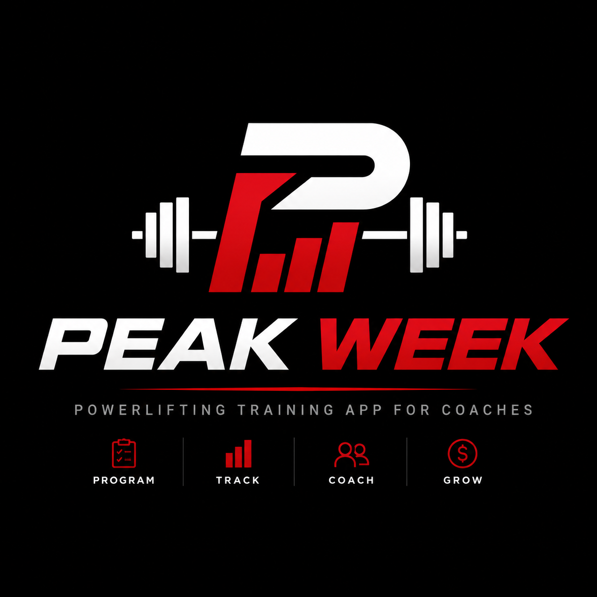

  

<h1 align="center">Peak Week</h1>

  <b>Powerlifting coaching, built for Apple devices.</b> 
  Coaches build the program. Lifters get their week. Results come straight back.

  <a href="https://apps.apple.com/app/id6797750329"><b>Get Peak Week Lifter on the App Store</b></a>
  &nbsp;·&nbsp;
  <a href="https://rickndanger-ctrl.github.io/PeakWeek/apple/support.html">Support</a>
  &nbsp;·&nbsp;
  <a href="https://rickndanger-ctrl.github.io/PeakWeek/apple/privacy.html">Privacy</a>

---

## Two apps, one coaching relationship

**Peak Week Coach** (Mac, iPhone and iPad)
Plan each lifter's meet prep, customize every set, and publish one week at a time. You review every week before it goes out.

**Peak Week Lifter** (iPhone and iPad, free)
Open your coach's invitation, sign in with Apple, and your training is there. Log your sets, add an optional video, and send notes back to your coach.

## What it does

- **Program:** block-periodized meet prep built on established strength-training principles, fully customizable per lifter.
- **Deliver:** publish a training week and it appears directly in the lifter's app.
- **Track:** lifters log weight, reps and effort (RPE). Results sync back to the coach even after the phone has been offline.
- **Coach:** lifters can send lift videos, and coaches can send video reviews back, all private to the coaching relationship.

## Private by design

- Sign in with Apple. Peak Week never sees your Apple password.
- No ads and no cross-app tracking.
- Lifters can delete their account and all linked training at any time.

Read the full [privacy policy](https://rickndanger-ctrl.github.io/PeakWeek/apple/privacy.html).

## Need help?

- Setup guides and answers: [Peak Week Support](https://rickndanger-ctrl.github.io/PeakWeek/apple/support.html)
- Report a problem: [open an issue](https://github.com/rickndanger-ctrl/PeakWeek/issues). Please include your app version, your device, and what happened.
- For a private account or data request, open an issue asking for a private contact channel. Please don't post personal details publicly.

---

Peak Week's source code is private. This repository hosts the public support site, privacy policy and issue tracker.
